# 测试结果
各个关卡通过公开测试以及一个非公开测试的随机种子测试图片如下：
## 1
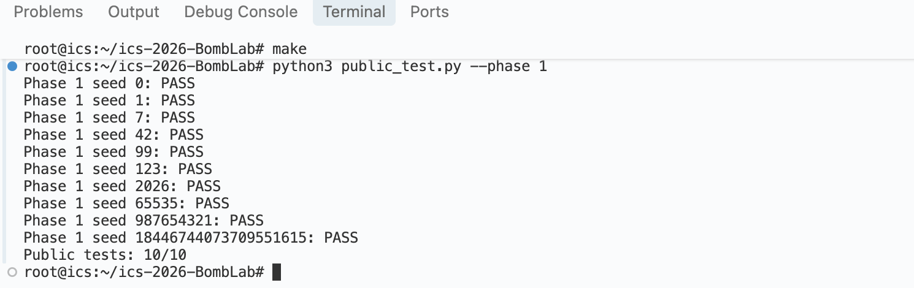
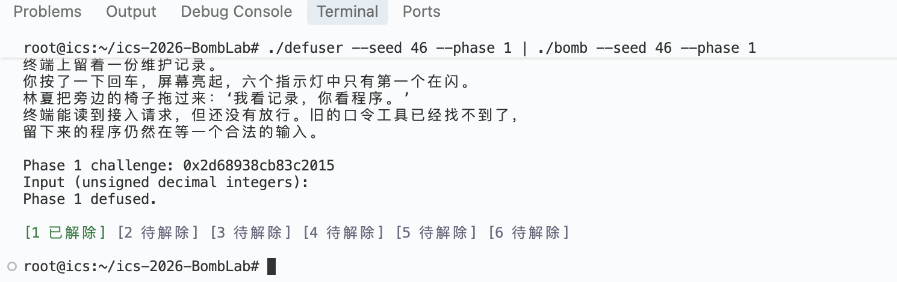
## 2

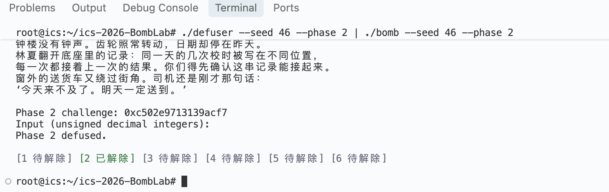
## 3

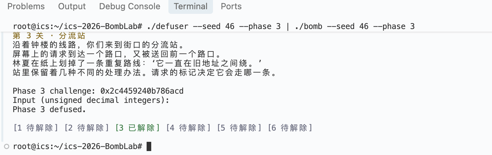
## 4
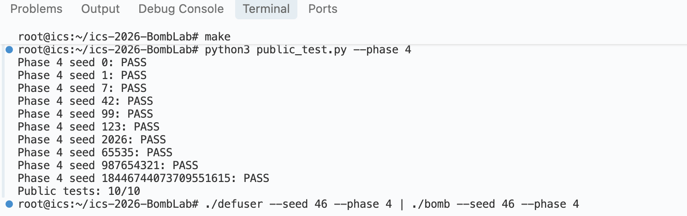
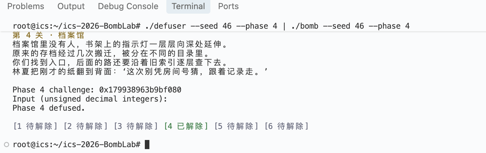
## 5
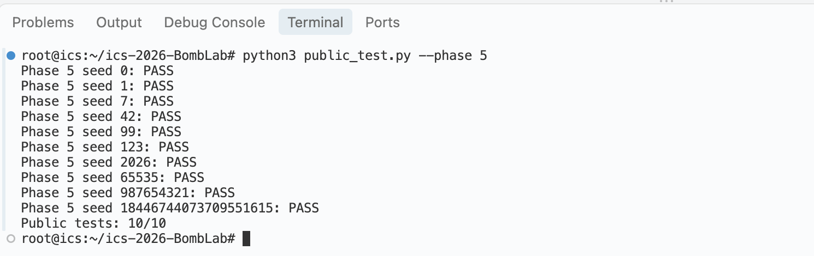
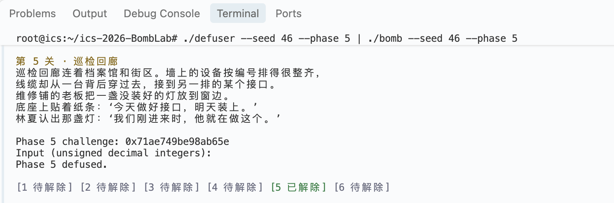
## 6
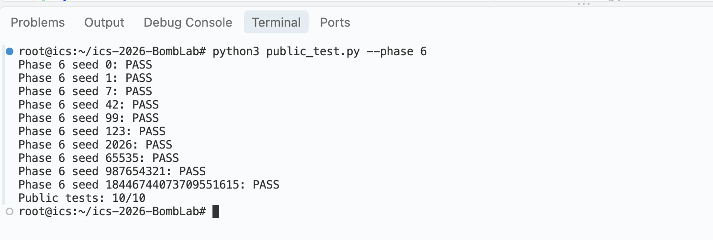
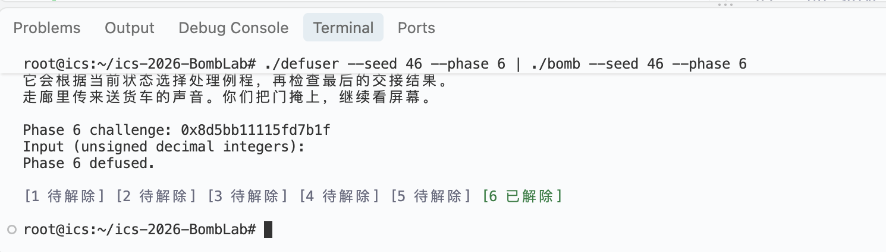
## secret
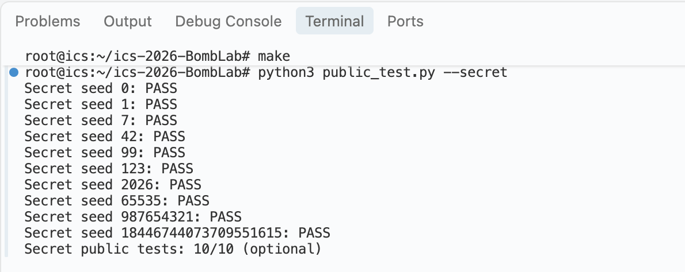
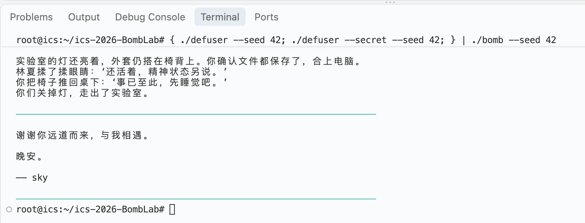

# phase_01
在终端进入BombLab的文件夹后，通过`objump`打印出各关的汇编代码，并进行分析。
## callee：p1_compute
根据被调用函数`p1_compute`中参数的传递关系，可以得到：

|           | edi          | esi                  |
| --------- | ------------ | -------------------- |
| 调用step2之前 | 原始64位参数的高32位 | 原始64位参数的低32位         |
| 调用step0之前 | 原始64位参数的低32位 | 原始64位参数逻辑右移16位后的低32位 |
| 调用step1之前 | step0的返回值    | step2的返回值            |
因此可以画出这个函数的流程图：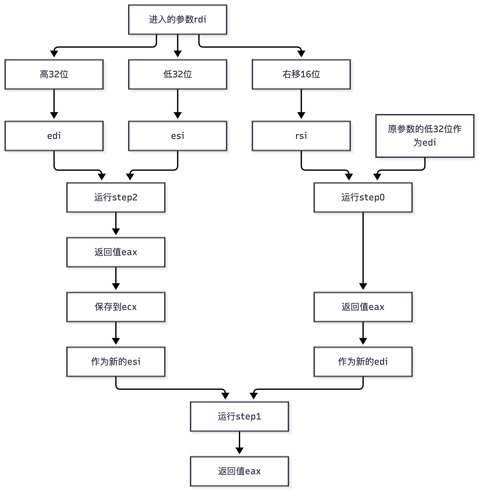
于是我们知道，`p1_compute`根据传入的一个参数经过调用其他三个用于计算的函数，最后返回一个值。接下来分析调用函数`phase_01`：
## caller：phase_01
根据主函数`phase_01`的参数传递关系，可以得到以下流程图：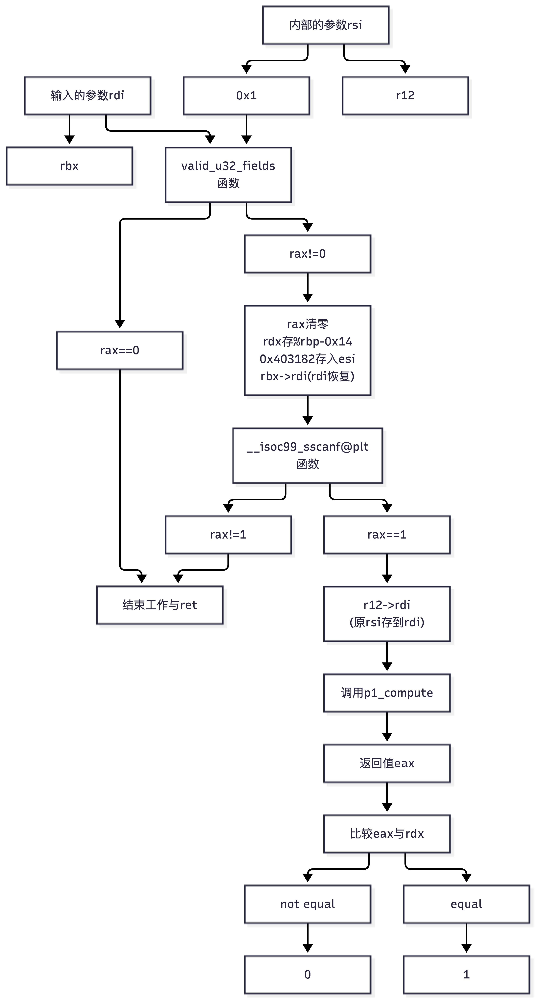
其中结束工作包括恢复栈顶指针、弹出栈中存储的元素。

其中引用的其他函数作用为：
- `valid_u32_fields`：验证输入是否合法
- `__isoc99_sscanf`：将输入rdi解析为整数

由此，主函数即比较内部参数`rsi`经过函数`p1_compute`后的返回值与输入`rdi`的值，如果相等，则炸弹不会爆炸。于是通过gdb，我们在程序刚开始时打断点，查看`rsi`的值。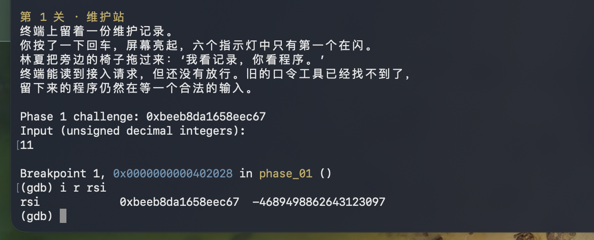
在获得`rsi`的初始值之后，把它作为rdi带入函数`p1_compute`，结果是`3724947401`。于是输入，解除了炸弹。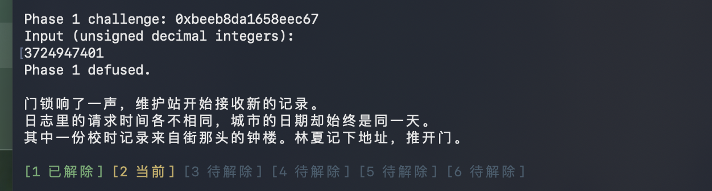
# phase_02
函数`phase_02`流程图示意如下：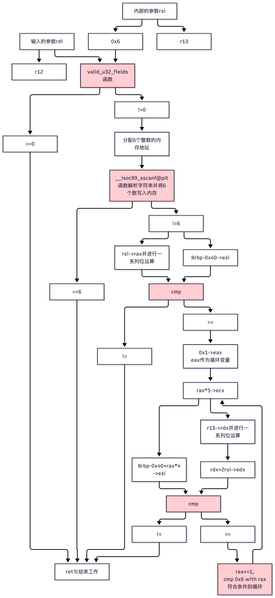
首先使用valid函数检查是否输入了6个整数，随后分配6个整数的内存地址。
```
lea    -0x2c(%rbp),%rax
lea    -0x3c(%rbp),%rcx
mov    $0x403173,%esi
push   %rax
lea    -0x30(%rbp),%rax
lea    -0x40(%rbp),%rdx
mov    %r12,%rdi
push   %rax
lea    -0x34(%rbp),%r9
lea    -0x38(%rbp),%r8
```
这一段汇编代码表示，为6个输入的整数准备了连续的内存地址，于是相当于创建了一个数组。然后通过`sscanf`函数解析字符串并将这6个数存入内存。接下来让`esi`存储数组第一个元素，比较是否满足，然后让`eax=1`作为循环变量，则`esi`存储的地址即为`%rbp-0x40+rax*4`，检查是否满足，如果满足，则`eax+=1`，进行循环，直到`eax=6`时，结束循环。

首先，当`esi`存储数组第一个元素时，内部参数`rsi`进行一系列运算后与这个元素进行比较。因此，我们需要读取`rsi`的值，以计算出第一个元素。于是，通过gdb，我们在程序刚开始时打断点，查看`rsi`的值。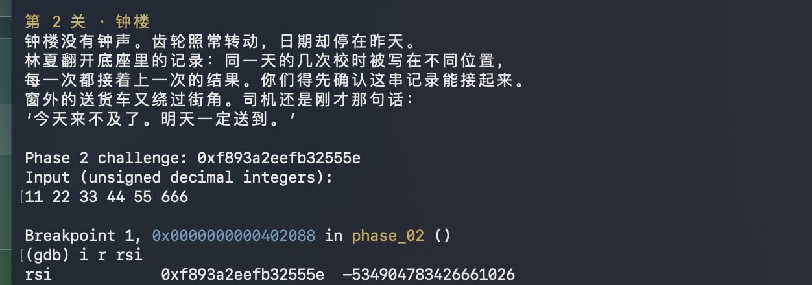
接下来，根据循环中的计算，按照内存地址从小到大的顺序求出接下来的五个元素的值。最终输入结果，解除了炸弹。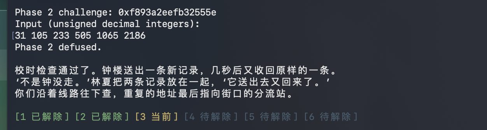
# phase_03
## dispatch
首先分析汇编代码得到`dispatch`连同它调用case函数的流程图如下：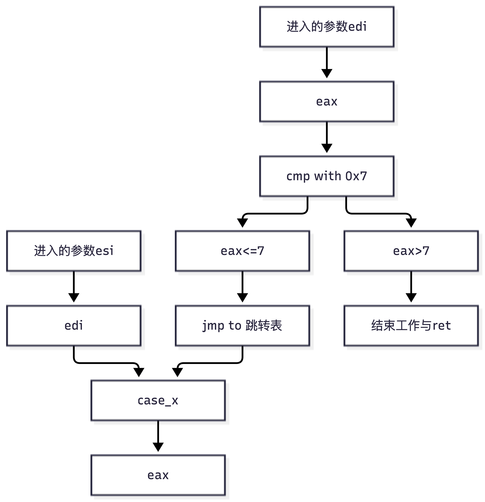
其中，这一句汇编表示跳转至一个跳转表：
```
4021cd: 3e ff 24 c5 e0 57 40 notrack jmp *0x4057e0(,%rax,8)
```
最初我们使用的 `-d` 表示查看反汇编可执行代码，它主要把被识别为代码的区域解释成汇编指令。但跳转表本身并不是一系列需要执行的指令，而是一组数据：每个表项保存一个跳转目标地址。因此，没能直接看到跳转表的信息。

我们通过gdb中的以下操作查看跳转表内容：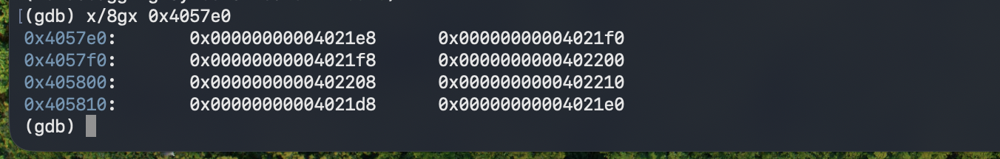
再结合以下汇编：
（注意在这里，nop把每个跳板占用的空间补齐到了 8 字节。跳转表每个表项占 8 字节，而这些跳板也被安排成每隔 8 字节一个。这是一种方便、规整的布局方式。）
```
  4021d4: 00 
  4021d5: 0f 1f 00             nopl   (%rax)
  4021d8: eb a6                jmp    402180 <p3_case_4>
  4021da: 66 0f 1f 44 00 00    nopw   0x0(%rax,%rax,1)
  4021e0: eb be                jmp    4021a0 <p3_case_6>
  4021e2: 66 0f 1f 44 00 00    nopw   0x0(%rax,%rax,1)
  4021e8: eb c6                jmp    4021b0 <p3_case_7>
  4021ea: 66 0f 1f 44 00 00    nopw   0x0(%rax,%rax,1)
  4021f0: e9 7b ff ff ff       jmp    402170 <p3_case_3>
  4021f5: 0f 1f 00             nopl   (%rax)
  4021f8: eb 96                jmp    402190 <p3_case_5>
  4021fa: 66 0f 1f 44 00 00    nopw   0x0(%rax,%rax,1)
  402200: e9 4b ff ff ff       jmp    402150 <p3_case_2>
  402205: 0f 1f 00             nopl   (%rax)
  402208: e9 23 ff ff ff       jmp    402130 <p3_case_0>
  40220d: 0f 1f 00             nopl   (%rax)
  402210: e9 2b ff ff ff       jmp    402140 <p3_case_1>
```
得到进入`case`函数之前的`eax`（即`dispatch`函数的参数`edi`）的值与实际调用哪个`case`函数的关系，及函数对应的算式入下表所示：

| dispatch函数的参数edi | 实际调用的函数     | 返回值 eax                     |
| :--------------: | ----------- | --------------------------- |
|        0         | `p3_case_7` | \(3y+0xE84C\)               |
|        1         | `p3_case_3` | \(5y+0xFE5\)                |
|        2         | `p3_case_5` | \((y\oplus0x8C50)+(y\gg1)\) |
|        3         | `p3_case_2` | \((4y)\oplus0xD228\)        |
|        4         | `p3_case_0` | \((y\oplus0x8B00)+(y\gg1)\) |
|        5         | `p3_case_1` | \(5y+0x192EE\)              |
|        6         | `p3_case_4` | \((2y)\oplus0x1099\)        |
|        7         | `p3_case_6` | \(5y+0x38789\)              |
其中，第三列里的y是`case`函数的`rdi`，即`dispatch`函数的`rsi`。

把上面的内容进行封装📦，有：
>`call p3_dispatch`随后跳转至`case x`作为整体
>输入：rdi作为索引标签；rsi作为`case x`的参数
>输出：eax是`case x`的运算结果
## p3主函数
接下来，分析`phase_03`函数的代码。做出流程图如下：
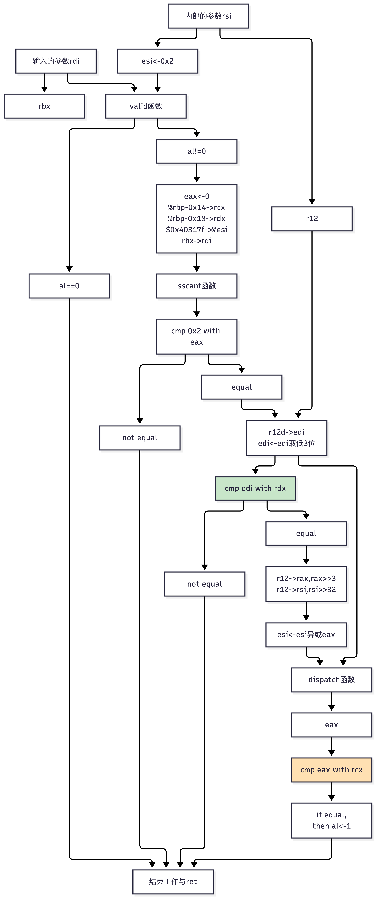
其中，如果用户输入了由两个整数（用空格分隔）组成的字符串，`sscanf`函数就会将它们解析为两个整数，分别存入`%rdx`与`%rcx`。`sscanf`函数的参数`rdi`是待解析的字符串，
```
  40225a: be 7f 31 40 00       mov    $0x40317f,%esi
```
这句汇编说明一个地址被放入了`esi`寄存器。通过在gdb中输入`x/s`把 `0x40317f` 处的数据作为字符串显示，确认这个地址指向格式字符串：无符号整数。
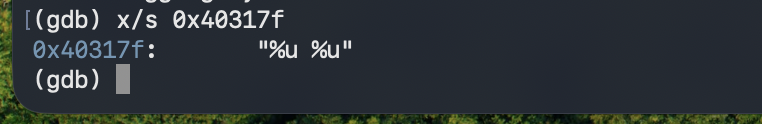
上流程图中将分析用户输入什么才能解除炸弹的关键步骤标上了颜色：第一个整数`rdx`是主函数`rsi`的低3位，第二个整数`rcx`是`dispatch`函数返回的`eax`。注意到`dispatch`函数的运行完全由主函数内部的参数`rsi`决定。因此，只需要知道函数最初的`rsi`，经过一系列计算，即可得到正确的输入。
通过gdb打断点，得到`rsi`的值：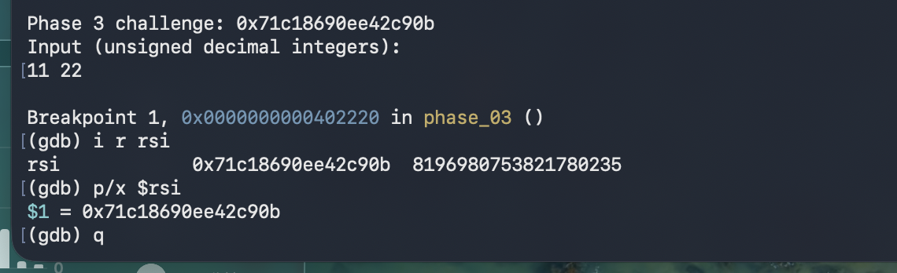
随后，经过一系列计算，就得到了解除炸弹的正确答案：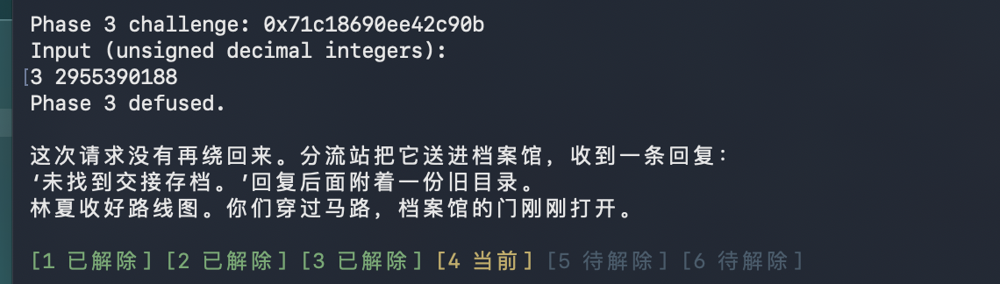
# phase_04
## walk
`p4_walk` 是一个递归的二分查找函数。它首先计算当前区间 `[low, high]` 的中点 `mid`，然后将目标值 `x` 与中点比较：若相等，则返回 `(mid + 168) ^ c`；若 `x < mid`，则递归搜索左半区间；否则递归搜索右半区间。每次递归返回后，函数将结果乘以 3，与 `mid + c` 进行异或，再根据搜索方向与不同常数异或，最终得到一个编码后的返回值。
其运行的流程图如下：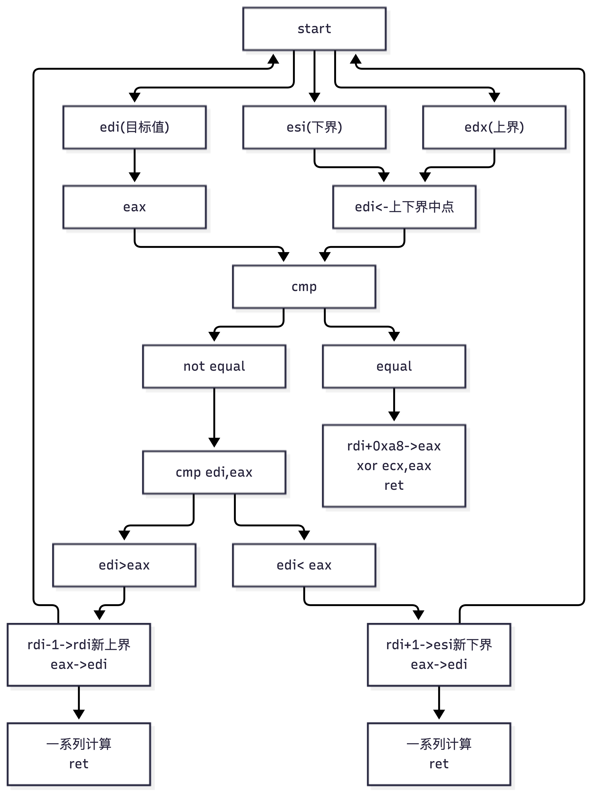
## p4主函数
主函数的流程图如下（省略了`valid`函数和`sscanf`函数的调用相关的详细过程）：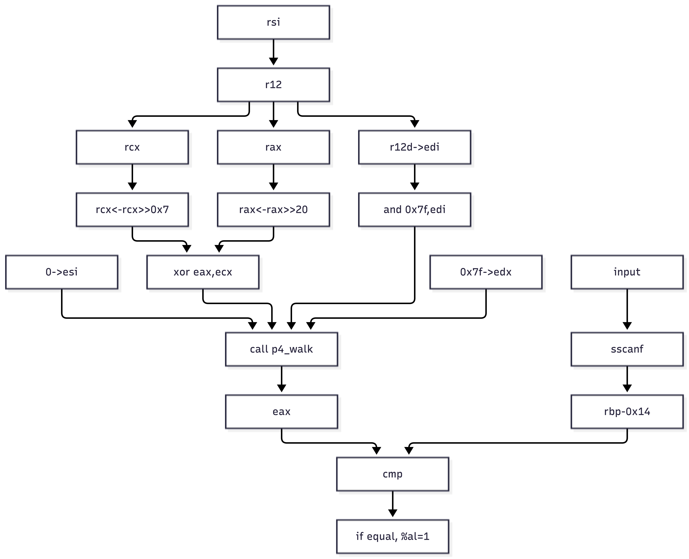
`phase_04` 首先检查输入格式是否合法，并使用 `sscanf` 读取用户输入的一个无符号整数。在gdb查看格式字符串的操作如下：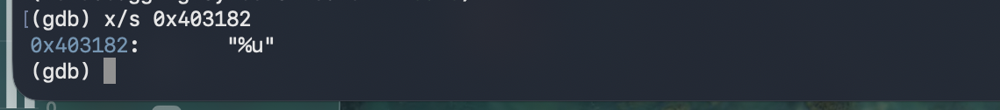
随后，它从传入参数 `r12` 中提取并计算出 `p4_walk` 所需的四个参数：目标值 `x`、区间下界 `0`、上界 `127` 和辅助参数 `c`。调用 `p4_walk` 后，函数将其返回值与用户输入的整数比较：若相等，则返回 `1`，否则返回 `0`。
为了找到什么是正确的输入，首先查看主函数调用`walk`函数时参数的值。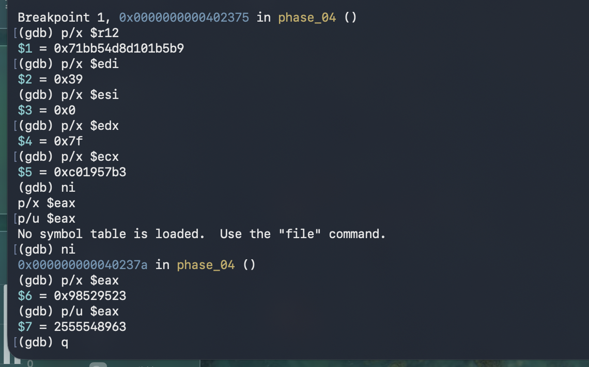于是，经过一系列计算，可以得到正确的输入，成功解除了炸弹。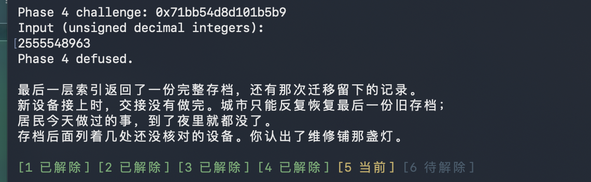
# phase_05
## traverse
`p5_traverse` 汇编代码的核心功能是，根据第一个参数 `rdi` 计算一个初始节点，然后沿着链表向后遍历若干个节点，在遍历过程中不断更新计算结果，并通过第二个参数 `rsi` 所指向的内存返回最后一个节点的值。函数流程图如下：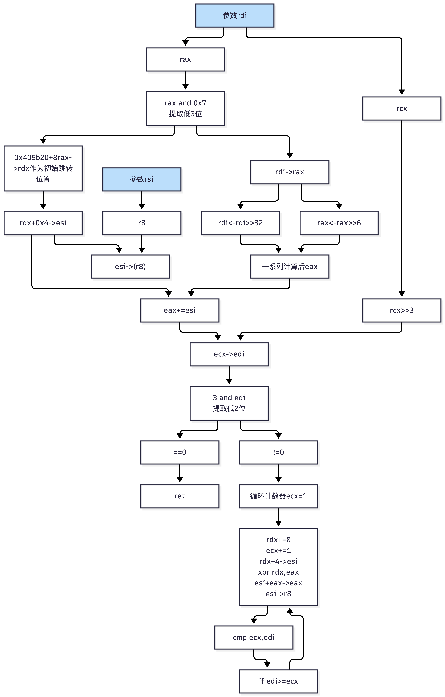

函数体现了**结构体布局**：每个节点占据一段连续内存，包含 `data`、`value` 和 `next` 三个字段。根据汇编和内存数据，可以推断 `data` 位于偏移 `+0`，`value` 位于偏移 `+4`，`next` 指针位于偏移 `+8`。

函数接收 `rsi` 中的 64 位整数作为参数，并通过 `x & 7` 计算起始节点的索引，从跳转表 `p5_heads` 中找到链表起点。随后，计算遍历次数 `n = (x >> 3) & 3`。函数先利用输入整数的部分位、节点的 `data` 字段及常数 `0x4739` 进行异或运算，再加上节点的 `value` 字段。之后，每访问一个后续节点，就将结果与该节点的 `data` 异或，再加上 `value`。最终，函数返回计算结果，并通过指针参数保存最后访问节点的 `value`。
## p5主函数
函数流程图如下（省略了`valid`函数和`sscanf`函数的调用相关的详细过程）：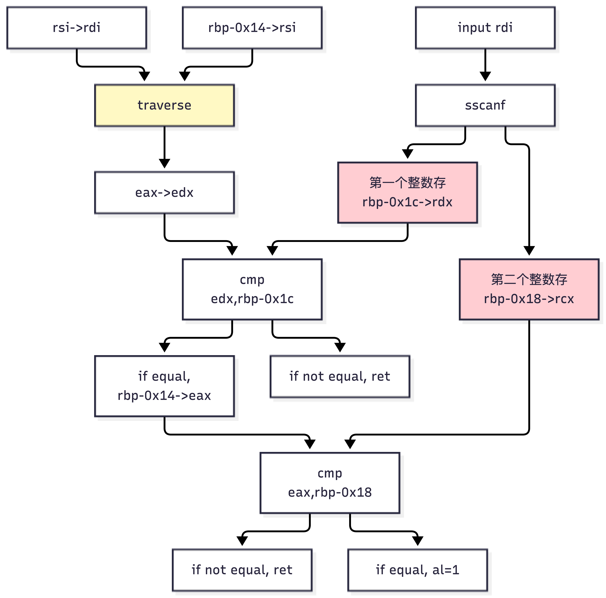
`phase_05` 首先调用 `valid_u32_fields` 检查输入格式，再通过 `sscanf` 读取两个无符号整数。随后调用 `p5_traverse`，将返回值与第一个输入比较，并将最后访问节点的 `value` 与第二个输入比较，两者均匹配才算通过。
调试时，查看 `rsi`是为了获取 `p5_traverse` 使用的原始 64 位参数；查看跳转表（`x/8gx 0x405b20`）是为了确定不同索引对应的起始节点地址（如下图）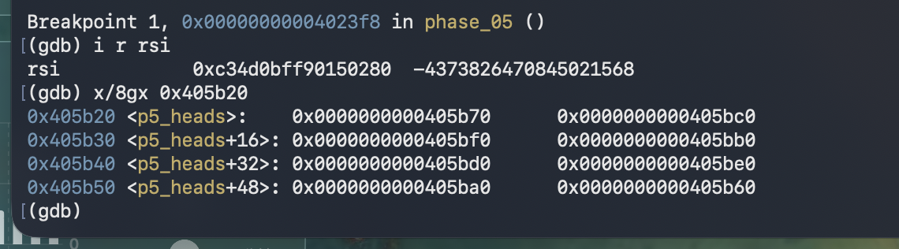
命令 `x/4wx 0x405b70` 则从 `0x405b70` 开始，以 4 字节为单位查看 4 个十六进制数，帮助识别节点的 `data`、`value` 等字段。如下图所示：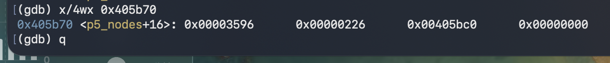最终经过一系列计算，成功解除炸弹。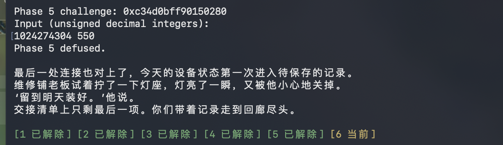

# phase_06
## dispatch
`p6_dispatch` 接收一个 64 位整数作为输入，首先将输入保存到 `rbx`，再通过移位、异或和掩码运算提取不同位段的信息。随后，利用输入的低 3 位作为索引，从 `p6_ops` 跳转表中选择第一个函数并调用。查看跳转表对应关系的操作如图：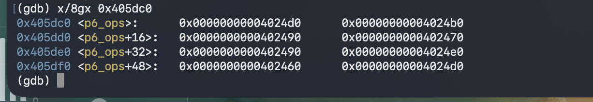
第一次调用返回的结果与 `0xf803` 进行异或后，作为第二次调用的参数；同时，原始输入经过 `and $0x38` 运算，确定第二次调用的跳转表索引。第二次调用结束后，将返回值加上 `0x599`，作为整个函数的最终返回值。函数流程图如下：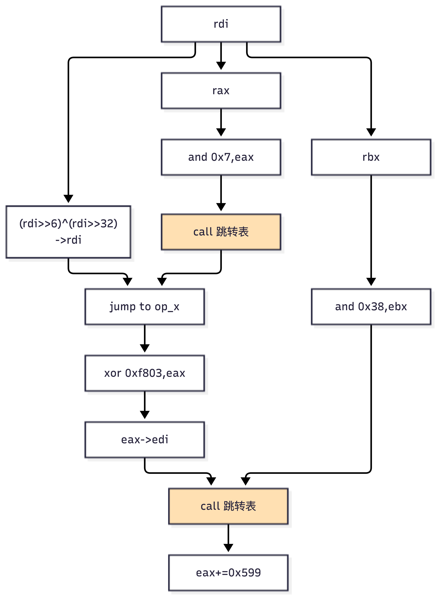
## p6主函数
主函数流程图如下：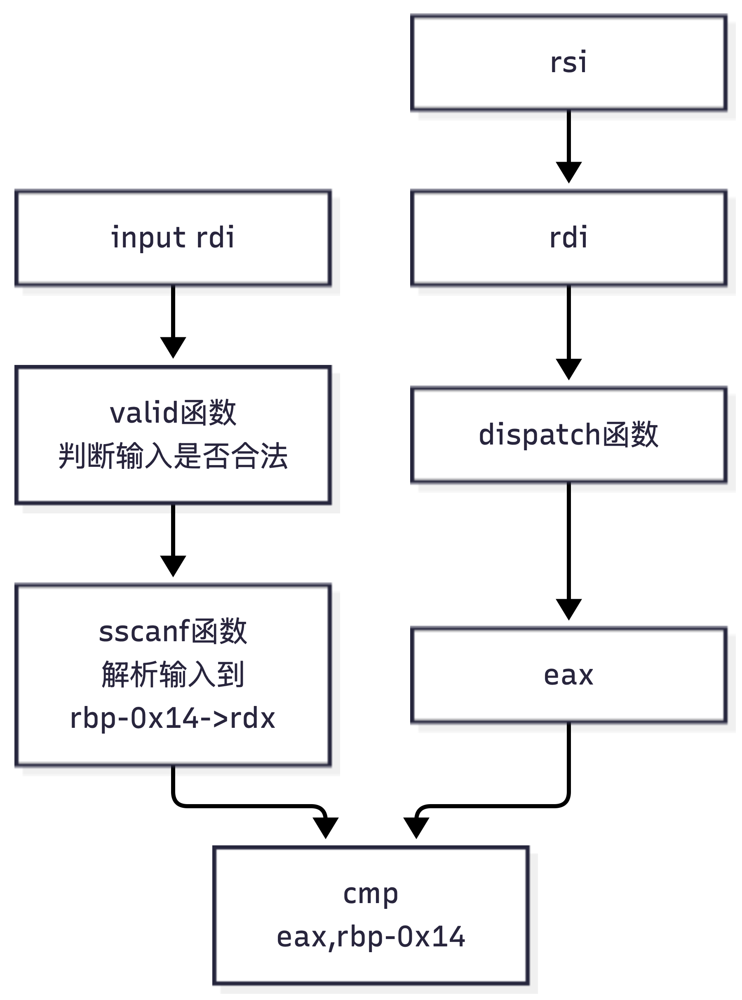
`phase_06` 首先调用 `valid_u32_fields` 检查输入格式是否合法，然后通过 `sscanf` 将用户输入解析为一个无符号整数，保存在栈上的局部变量中。接着，主函数将预先保存的参数传入 `p6_dispatch`，获得计算结果。最后，使用 `cmp` 比较计算结果与用户输入，并通过 `sete` 将比较结果转换为布尔值：若两者相等，则返回 1，否则返回 0。

因此，只需查看内部参数rsi即可得到需要的输入。如图查看`rsi`：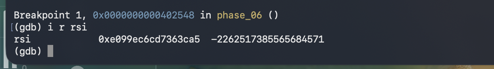
于是成功解除炸弹。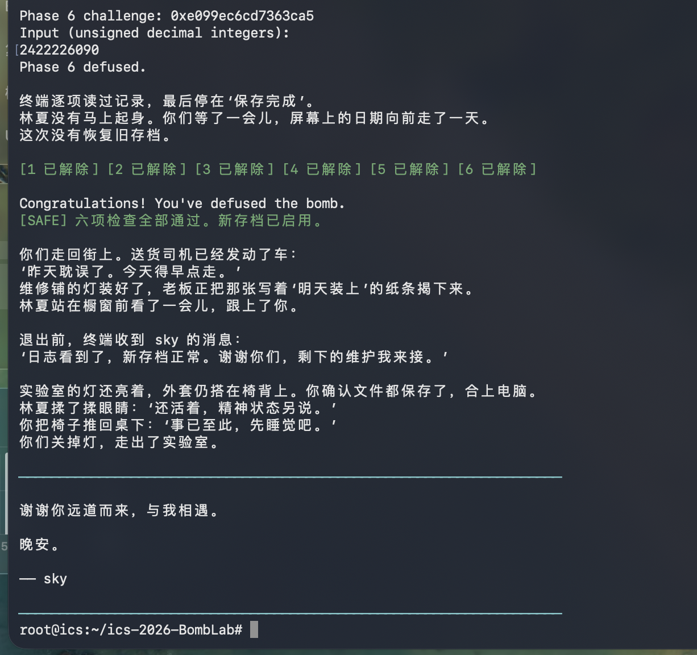

# 使用的辅助工具
借助ai进行了部分汇编代码含义的学习，以及必要的计算。